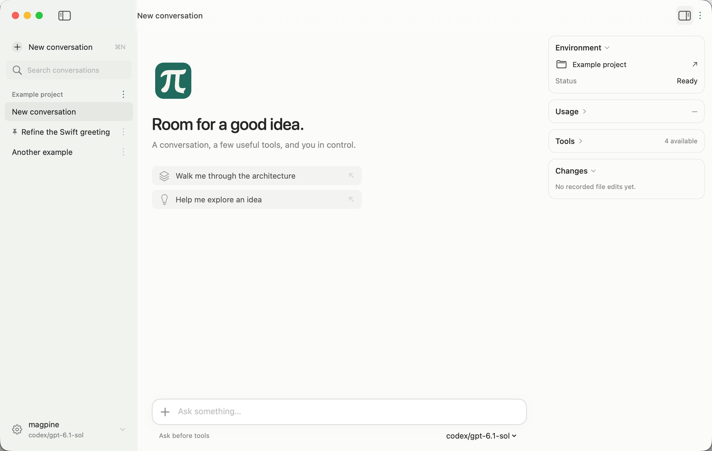

<p align="center">
  
</p>

# Pi Swift

**A native Swift agent runtime, a small coding CLI, and composable chat UI.**

[](https://github.com/chenqing/pi-swfit/actions/workflows/ci.yml)

Community Swift port of [earendil-works/pi](https://github.com/earendil-works/pi), extracted from [Pagie](https://github.com/chenqing/pagie). Not an official Pi distribution and not a complete port of upstream main. Runtime names and event semantics follow Pi; native presentation lives in separate modules.

The repository is named **`pi-swfit`**. The product is **Pi Swift**, and the command is **`pf`**.

## A quiet native interface



Native Markdown, copyable code, reviewable changes, and a conversation that fits beside your work. [Icon and theme](Docs/BRAND.md).

## Try it

[Download Pi Swift for Apple Silicon](https://github.com/chenqing/pi-swfit/releases/latest) — macOS 14+, Developer ID signed and Apple-notarized. Open the DMG and drag Pi Swift into Applications. The app includes the `pf` CLI; release assets include SHA-256 checksums.

Building from source requires macOS 14+ and a Swift 6 toolchain. Apple Silicon is the validated platform. No Node runtime is needed for Swift products; the optional upstream MCP conformance runner uses Node.

```sh
git clone https://github.com/chenqing/pi-swfit.git
cd pi-swfit
swift run pf --demo -p "Hello"
./scripts/run-app.sh
```

Pi Swift starts with an **offline demonstration** that runs through the actual Agent loop, including per-call approval, streaming, tool execution, and cancellation. Open **More → Manage connections…** to select a project folder and save a provider connection in Keychain. Live conversations use the same `PiCodingAgent.AgentSession` and JSONL files as `pf`; the last workspace and conversation reopen on launch. File edits show a diff before approval. It also includes failure/long-stream/rich-Markdown scenarios, light/dark appearance, a collapsible sidebar with search, rename, pin and reversible archive, and a right-hand session inspector for workspace, token usage, tool activity and recorded edits. The composer offers quick switching between saved models without losing the conversation or draft. Drafts autosave locally, restore after restarting, and remain accessible from the sidebar even before the first message. Suggestions and inserted text preserve existing input and support native undo/redo. Failed requests offer a return-to-draft action and connection settings. Search includes conversation text with excerpts and matching-message navigation. The header title opens Rename; sidebar width, visibility and appearance are remembered. Tool rows summarize actions and keep raw output behind a disclosure. File summaries open an independent diff window with old/new line numbers, wrapping, hunk navigation, record switching and copy support. Use the top-right sidebar button or Option-Command-I to show details; narrow windows use a popover. The script builds `.build/Pi Swift.app` with its icon and resource bundle; `./scripts/build-app.sh release` creates a local release build without opening it.

## `pf` — Pi for Swift

```sh
# Supply your provider key through its environment variable, e.g. OPENAI_API_KEY.
swift run pf --provider openai --model YOUR_MODEL -p "Explain this project"
swift run pf --provider openai --model YOUR_MODEL --mode json "Explain this project"
swift run pf --provider openai --model YOUR_MODEL --continue
swift run pf --demo --no-session -p "No key needed"
```

`pf` uses **PiCodingAgent.AgentSession**, including its session manager and compaction behavior. It provides a line-oriented REPL, print mode, JSONL events, stdin, session resume, and native `read`, `bash`, `edit`, `write` tools. Those tools run with your user's permissions; `--no-tools` gives a chat-only session. Sessions default to `~/.pf/agent`, separate from upstream Pi. See [CLI usage and differences](Docs/CLI.md).

To install the CLI locally:

```sh
swift build -c release --product pf
mkdir -p "$HOME/.local/bin"
cp "$(swift build -c release --show-bin-path)/pf" "$HOME/.local/bin/pf"
# Add ~/.local/bin to PATH if it is not already there.
```

## Add native chat to an app

```swift
.package(url: "https://github.com/chenqing/pi-swfit.git", branch: "main")
```

Choose products independently:

| Product | Responsibility |
| --- | --- |
| `PiAI` | Provider requests, message types, streaming, authentication |
| `PiAgent` | Agent loop, tool execution, events, steering and cancellation |
| `PiMCP` | Native MCP client, transports and OAuth |
| `PiCodingAgent` | Sessions, persistence, compaction, resources, skills and native extensions |
| `PiHost` | Shared coding tools, Keychain connections, workspace paths and session ownership |
| `PiChat` | Main-actor conversation presentation and approval adapter for Agent / AgentSession |
| `PiUI` | SwiftUI conversation, message, composer, tool and approval components |
| `PiCLI` | `pf` argument parsing and CLI presentation |

For an offline SwiftUI preview:

```swift
import SwiftUI
import PiChat
import PiUI

@MainActor
struct DemoView: View {
    @State private var session: ChatSession?
    @State private var error: String?

    var body: some View {
        Group {
            if let session {
                ConversationView(session: session)
                    .chatTheme(ChatTheme(accent: .teal))
            } else if let error {
                Text(error)
            }
        }
        .task {
            do { session = try makeDemoSession() }
            catch { self.error = String(describing: error) }
        }
    }
}
```

For an in-memory model, create `ChatSession(options: AgentOptions(...))`. For a persistent coding workspace, use `ChatSession.openCoding(cwd:profile:store:sessionFile:)`. Both routes consume runtime events; they do not rebuild the model transcript from display text. See [native UI integration](Docs/UI.md) and [shared host storage](Docs/HOST.md). Branch navigation and specialized compaction/retry UI are still outside this release.

After saving a connection in Pi Swift, quit it to release the active session, then run from that workspace:

```sh
pf --list-connections
pf --connection "My model" --continue
```

macOS may ask you to authorize each executable's Keychain access, especially after rebuilding unsigned development binaries. `PF_API_KEY` provides an explicit per-process alternative for automation; it is never saved by the host.

## Upstream compatibility

The project uses **pinned, selective porting**, not a blanket “fully compatible” claim. [The compatibility record](Docs/UPSTREAM.md) lists source revisions, backported fixes, platform differences and remaining gaps. [PORTING.md](PORTING.md) preserves historical translation conventions. `scripts/check-upstream.py` compares tracked upstream file blobs without changing the pins.

Not included in this first release: full terminal TUI, RPC mode, JavaScript/npm extension loading, browser tools, iOS UI validation, attachment rendering, or a production release installer. The default message view renders native Markdown headings, lists, quotes, tables and copyable code blocks. Applications can also inject their own renderer.

## Development

```sh
swift test
python3 scripts/smoke-cli.py
swift build -c release --product pf
```

Tests use synthetic provider transports and local fixtures. Some imported tests require an external upstream checkout or a signed codemode helper and are conditionally skipped. Historical MCP results are in [Conformance](Conformance/README.md); they are not an all-green protocol certification.

## License

MIT for the original Pi code and Swift additions, with preserved third-party license notices for adapted provider SDK code. See [LICENSE](LICENSE) and [THIRD_PARTY_NOTICES.md](THIRD_PARTY_NOTICES.md).
